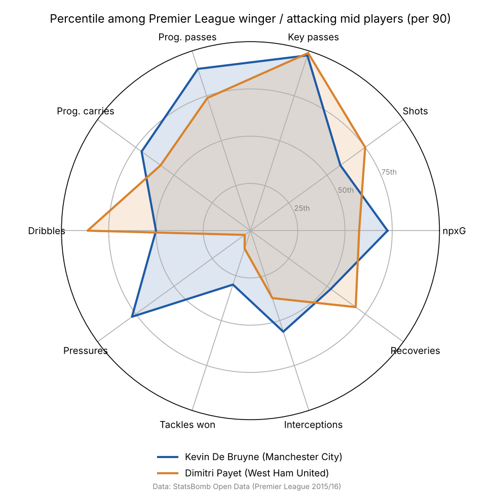

# Manchester City Player Similarity Model

A Python model that finds, for each Manchester City player, the Premier League players at other clubs whose game looks most like his. It uses StatsBomb's free event data for every match of the 2015/16 Premier League season. Every on-ball action is turned into per-90-minute performance features, which are standardized and compared with cosine similarity. The model also ranks every player in the league within his position using a weighted composite score, and draws radar charts comparing City players with their closest match.



## The question it answers

**"If Man City lost one of its players, who at another Premier League club plays most like him?"** That's the replacement question a recruitment team asks. Here the comparison is built on what players actually did per 90 minutes (shooting, chance creation, passing, carrying, pressing, defending), not on reputation or position labels.

## Data

| | |
|---|---|
| Source | [StatsBomb Open Data](https://github.com/statsbomb/open-data) (free, public event data) |
| Season | Premier League 2015/16, all 380 matches (38 involving Man City) |
| Players | 550 who appeared |
| Similarity pool | 305 outfield players from all 20 clubs with at least 900 minutes (10 full matches) |

2015/16 is the only men's Premier League season with Manchester City in StatsBomb's open data, which is why the project uses it.

The pipeline downloads the raw JSON (about 1.1 GB) into `data/raw/`, which is git-ignored. The repo only commits `data/sample/player_features_sample.csv` (about 70 KB): the per-90 features for the 305 players in the similarity pool. That lets the lookup script work straight after cloning.


**Data provided by StatsBomb.** This project follows the terms of the StatsBomb Open Data repository: the data source is credited as StatsBomb, with their logo.

## Method

1. **Minutes played.** Each player's minutes come from the lineup files: the time between entering and leaving the pitch, summed across matches. StatsBomb's clock restarts at 45:00 for the second half, so the code uses each half's real length (taken from the "Half End" events) to avoid double-counting first-half stoppage time.
2. **Position and club.** StatsBomb's 25 detailed positions are mapped to six groups: Striker, Winger / Attacking Mid, Central Midfield, Full Back, Center Back, Goalkeeper. Each player gets the group he played the most minutes in. A player who changed clubs mid-season is listed under the club he played the most minutes for.
3. **Event counts.** The code counts actions from the event data for each player:
   - **Shooting:** non-penalty goals, non-penalty xG (StatsBomb's expected goals), shots (excluding penalties)
   - **Creating:** assists, key passes (passes leading directly to a shot)
   - **Passing:** completed passes, pass completion %, progressive passes, passes into the final third
   - **Carrying:** progressive carries, completed dribbles
   - **Defending:** pressures, tackles won, interceptions won, ball recoveries, clearances, blocks, aerial duels won

   A **progressive** pass or carry moves the ball at least 10 yards toward the opponent's goal and ends in the opponent's half. Set pieces (corners, free kicks, throw-ins, goal kicks, kick-offs) are left out of the progressive and final-third pass counts, so those features describe open-play passing.
4. **Per-90 rates.** Every count is divided by minutes played and multiplied by 90, so players with different playing time can be compared. Pass completion stays a percentage. This gives 18 features.
5. **Scaling.** Each feature is converted to a z-score (StandardScaler) across the 305-player pool. Without this, passes (often 40+ per 90) would dominate goals (usually under 1 per 90) in any distance calculation.
6. **Cosine similarity.** Each player becomes an 18-number vector of z-scores. Cosine similarity measures the angle between two vectors, so it compares the *shape* of a profile (which things a player does more or less of than the league average) rather than raw size. A score of 1 means identical direction. By default, results are limited to the same position group and exclude the player's own teammates, since teammates share a system that makes their numbers look alike. Both defaults can be switched off.
7. **Composite leaderboard.** Within each position group (players with at least 1,350 minutes, or 15 full matches), each relevant feature is turned into a z-score against that group only, then combined as a weighted average. The weights are a judgment call about what matters in each role (for example, strikers weight npxG and goals most, center backs weight interceptions and aerial duels most). They're listed in `src/leaderboard.py`. Goalkeepers are not ranked.
8. **Radar charts.** Ten of the features are shown as percentile ranks within the player's position group. The City player is plotted against his single most similar player at another club.

## Example results

These tables are copied from the pipeline output (`python -m src.pipeline`).

**Kevin De Bruyne** (Winger / Attacking Mid)

| Similarity | Player | Club | Minutes |
|---|---|---|---|
| 0.928 | Dimitri Payet | West Ham United | 2,759 |
| 0.899 | Dušan Tadić | Southampton | 2,406 |
| 0.895 | Christian Eriksen | Tottenham Hotspur | 3,103 |
| 0.880 | Mesut Özil | Arsenal | 3,199 |
| 0.851 | Willian | Chelsea | 2,924 |

**Sergio Agüero** (Striker)

| Similarity | Player | Club | Minutes |
|---|---|---|---|
| 0.933 | Daniel Sturridge | Liverpool | 1,043 |
| 0.897 | Harry Kane | Tottenham Hotspur | 3,557 |
| 0.879 | Diego Costa | Chelsea | 2,541 |
| 0.876 | Odion Ighalo | Watford | 3,340 |
| 0.816 | Romelu Lukaku | Everton | 3,389 |

**Fernandinho** (Central Midfield)

| Similarity | Player | Club | Minutes |
|---|---|---|---|
| 0.911 | Gareth Barry | Everton | 3,054 |
| 0.868 | Lucas Leiva | Liverpool | 2,098 |
| 0.857 | Harry Arter | AFC Bournemouth | 1,737 |
| 0.856 | Cesc Fàbregas | Chelsea | 3,113 |
| 0.847 | Bastian Schweinsteiger | Manchester United | 1,272 |

**Man City squad: league rank and closest match** (players with 1,350+ minutes; full table in `outputs/man_city_squad.csv`)

| Player | Position group | League rank in position | Most similar at another club |
|---|---|---|---|
| Fernandinho | Central Midfield | 7 of 57 | Gareth Barry (Everton) |
| Nicolás Otamendi | Center Back | 1 of 51 | Kolo Touré (Liverpool) |
| Bacary Sagna | Full Back | 19 of 46 | Kyle Naughton (Swansea City) |
| Sergio Agüero | Striker | 1 of 27 | Daniel Sturridge (Liverpool) |
| Yaya Touré | Central Midfield | 12 of 57 | Santi Cazorla (Arsenal) |
| Aleksandar Kolarov | Full Back | 8 of 46 | Aaron Cresswell (West Ham United) |
| Jesús Navas | Winger / Attacking Mid | 22 of 65 | Moussa Sissoko (Newcastle United) |
| Eliaquim Mangala | Center Back | 44 of 51 | Gabriel Paulista (Arsenal) |
| Kevin De Bruyne | Winger / Attacking Mid | 6 of 65 | Dimitri Payet (West Ham United) |
| Raheem Sterling | Winger / Attacking Mid | 17 of 65 | Marko Arnautović (Stoke City) |
| David Silva | Winger / Attacking Mid | 3 of 65 | Mesut Özil (Arsenal) |
| Fernando Reges | Central Midfield | 39 of 57 | Francis Joseph Coquelin (Arsenal) |

**League leaderboard, top 3 per position** (full table in `outputs/leaderboard_by_position.csv`)

| Position | 1st | 2nd | 3rd |
|---|---|---|---|
| Striker | Sergio Agüero (Man City) | Christian Benteke (Liverpool) | Harry Kane (Tottenham) |
| Winger / Attacking Mid | Mesut Özil (Arsenal) | Alexis Sánchez (Arsenal) | David Silva (Man City) |
| Central Midfield | Santi Cazorla (Arsenal) | Cesc Fàbregas (Chelsea) | Aaron Ramsey (Arsenal) |
| Full Back | Àngel Rangel (Swansea) | Séamus Coleman (Everton) | Christian Fuchs (Leicester) |
| Center Back | Nicolás Otamendi (Man City) | Mamadou Sakho (Liverpool) | Virgil van Dijk (Southampton) |

## How to run it

```bash
pip install -r requirements.txt
python -m src.pipeline                               # downloads data (first run only), writes outputs/
python similar_players.py "Kevin De Bruyne" --n 5    # works even before the pipeline, using the sample CSV
```

Names match on full name or nickname and ignore accents (`"aguero"` finds Sergio Agüero). If a name matches several players, the script lists them and asks you to be more specific. Add `--any-position` to search all outfield players and `--include-teammates` to allow players from the same club. From Python:

```python
from similar_players import similar_players
similar_players("Raheem Sterling", n=10)
```

## Repository structure

```
├── similar_players.py        # command-line lookup: player name -> top N similar players
├── src/
│   ├── config.py             # season, focus club and minute thresholds
│   ├── data_loader.py        # downloads and caches StatsBomb JSON
│   ├── features.py           # minutes played, event counts, per-90 features
│   ├── similarity.py         # z-score scaling + cosine similarity
│   ├── leaderboard.py        # composite score by position
│   ├── radar.py              # radar charts and long-format percentile export
│   └── pipeline.py           # runs everything end to end
├── data/sample/              # per-90 features for the 305-player pool (committed)
└── outputs/
    ├── man_city_squad.csv          # each City player's league rank and closest match
    ├── leaderboard_by_position.csv
    ├── radar_percentiles_long.csv  # one row per player x metric, ready for Tableau / Power BI
    └── radars/                     # PNG radar charts for De Bruyne, Agüero and Fernandinho
```

## Limitations

- **One season, and an old one.** 2015/16 is the only men's Premier League season with Man City in StatsBomb's open data. The results describe those players in that season, not today's squads.
- **Team context isn't modeled.** A center back on a team that defends deep makes more clearances than one on a possession team like City. The features describe what a player did, not how much his team's style shaped it. This is also why teammates are excluded by default.
- **Position is a single label.** It's the group with the most minutes. A player who split time between roles is compared only within his main group, and his features mix both roles.
- **Minutes still matter.** The 900-minute cut removes the noisiest players, but a player near the cut (Daniel Sturridge played 1,043 minutes) has less reliable rates than one with 3,000.
- **Equal feature weights in similarity.** All 18 features count the same, and several are correlated (shots and npxG, for example), so attacking output carries more total weight than any single defensive action.
- **Leaderboard weights are subjective.** They reflect one view of each role, not a validated model.
- **No goalkeeper model.** Goalkeepers are excluded from similarity and the leaderboard.

## Next steps

- Add more seasons if StatsBomb releases them, to compare players across years.
- Add possession-adjusted defensive stats so players from high- and low-possession teams compare fairly.
- Reduce correlated features with PCA before measuring similarity, and test how stable the top-5 lists are when matches are resampled.
- A small web front end for searching players.
