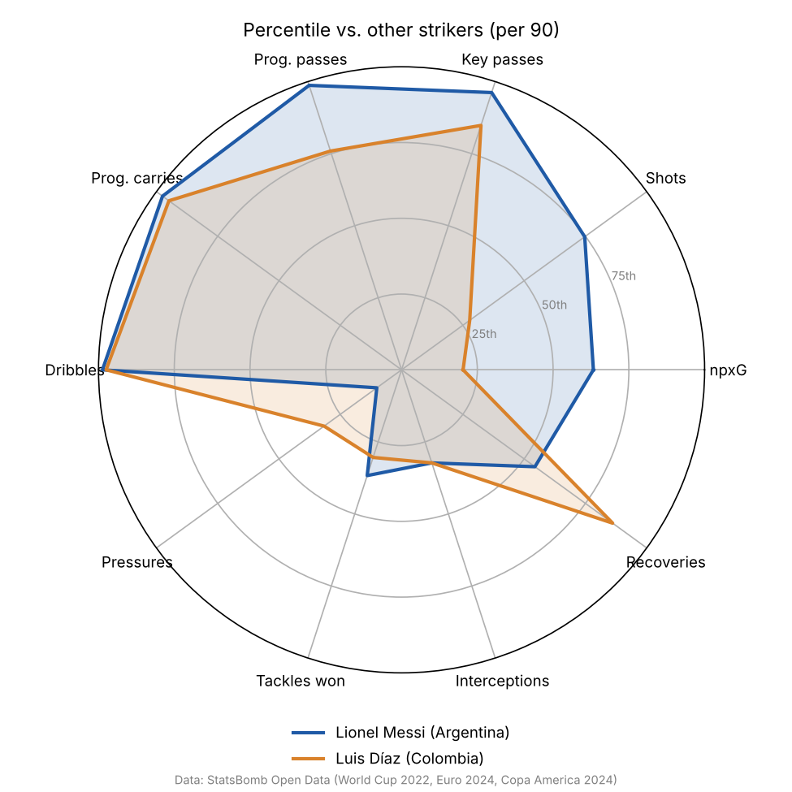

# Soccer Player Similarity Model

A Python model that finds statistically similar soccer players using StatsBomb's free event data. It turns every on-ball action from 147 international tournament matches into per-90-minute performance features, standardizes them, and uses cosine similarity to find each player's closest matches across three competitions. It also ranks players within their position with a weighted composite score and draws radar charts comparing a player with his closest match.



## The question it answers

**"Which players play most like Player X?"** That's the question a scout asks when a target is too expensive, unavailable or injured. Here the comparison is built on what players do per 90 minutes (shooting, passing, carrying, pressing, defending), not on reputation or position labels.

## Data

| | |
|---|---|
| Source | [StatsBomb Open Data](https://github.com/statsbomb/open-data) (free, public event data) |
| Competitions | FIFA World Cup 2022 (64 matches), UEFA Euro 2024 (51), Copa America 2024 (32) |
| Total | 147 matches, 1,270 players who appeared |
| Similarity pool | 629 outfield players with at least 180 minutes across the three tournaments |

The pipeline downloads the raw JSON (about 430 MB) into `data/raw/`, which is git-ignored. The repo only commits `data/sample/player_features_sample.csv` (about 150 KB): the per-90 features for the 629 players in the similarity pool. That lets the lookup script work straight after cloning.


**Data provided by StatsBomb.** This project follows the terms of the StatsBomb Open Data repository: the data source is credited as StatsBomb, with their logo.

## Method

1. **Minutes played.** Each player's minutes come from the lineup files: the time between entering and leaving the pitch, summed across matches. StatsBomb's clock restarts at 45:00 for the second half, so the code uses each period's real length (taken from the "Half End" events) to avoid double-counting stoppage time. Penalty shootouts are excluded.
2. **Position.** StatsBomb's 25 detailed positions are mapped to six groups: Striker, Winger / Attacking Mid, Central Midfield, Full Back, Center Back, Goalkeeper. Each player gets the group he played the most minutes in.
3. **Event counts.** The code counts actions from the event data for each player:
   - **Shooting:** non-penalty goals, non-penalty xG (StatsBomb's expected goals), shots (excluding penalties)
   - **Creating:** assists, key passes (passes leading directly to a shot)
   - **Passing:** completed passes, pass completion %, progressive passes, passes into the final third
   - **Carrying:** progressive carries, completed dribbles
   - **Defending:** pressures, tackles won, interceptions won, ball recoveries, clearances, blocks, aerial duels won

   A **progressive** pass or carry moves the ball at least 10 yards toward the opponent's goal and ends in the opponent's half. Set pieces (corners, free kicks, throw-ins, goal kicks, kick-offs) are left out of the progressive and final-third pass counts, so those features describe open-play passing.
4. **Per-90 rates.** Every count is divided by minutes played and multiplied by 90, so a substitute and a starter can be compared. Pass completion stays a percentage. This gives 18 features.
5. **Scaling.** Each feature is converted to a z-score (StandardScaler) across the 629-player pool. Without this, passes (often 40+ per 90) would dominate goals (usually under 1 per 90) in any distance calculation.
6. **Cosine similarity.** Each player becomes an 18-number vector of z-scores. Cosine similarity measures the angle between two vectors, so it compares the *shape* of a profile (which things a player does more or less of than average) rather than raw size. A score of 1 means identical direction. By default, results are limited to the same position group. The `--any-position` flag searches all outfield players.
7. **Composite leaderboard.** Within each position group (players with at least 360 minutes, roughly four full matches), each relevant feature is turned into a z-score against that group only, then combined as a weighted average. The weights are a judgment call about what matters in each role (for example, strikers weight npxG and goals most, center backs weight interceptions and aerial duels most). They're listed in `src/leaderboard.py`. Goalkeepers are not ranked.
8. **Radar charts.** Ten of the features are shown as percentile ranks within the player's position group. The player is plotted against his single most similar player.

## Example results

These tables are copied from the pipeline output (`python -m src.pipeline`).

**5 most similar to Lionel Messi** (grouped as a Striker: most of his minutes were logged at center forward)

| Similarity | Player | Team | Competitions | Minutes |
|---|---|---|---|---|
| 0.759 | Luis Díaz | Colombia | Copa America 2024 | 541 |
| 0.744 | Kvara | Georgia | Euro 2024 | 362 |
| 0.678 | Memphis Depay | Netherlands | World Cup 2022; Euro 2024 | 804 |
| 0.674 | Georges Mikautadze | Georgia | Euro 2024 | 369 |
| 0.666 | Arda Güler | Turkey | Euro 2024 | 361 |

**5 most similar to Toni Kroos** (Central Midfield)

| Similarity | Player | Team | Competitions | Minutes |
|---|---|---|---|---|
| 0.879 | Rúben Neves | Portugal | World Cup 2022; Euro 2024 | 420 |
| 0.876 | Granit Xhaka | Switzerland | World Cup 2022; Euro 2024 | 909 |
| 0.863 | Joey Veerman | Netherlands | Euro 2024 | 233 |
| 0.856 | Pedri | Spain | World Cup 2022; Euro 2024 | 585 |
| 0.854 | Aurélien Tchouaméni | France | World Cup 2022; Euro 2024 | 1,196 |

**5 most similar to Virgil van Dijk** (Center Back)

| Similarity | Player | Team | Competitions | Minutes |
|---|---|---|---|---|
| 0.918 | Dejan Lovren | Croatia | World Cup 2022 | 656 |
| 0.893 | Jannik Vestergaard | Denmark | Euro 2024 | 388 |
| 0.893 | Walker Zimmerman | United States | World Cup 2022 | 317 |
| 0.880 | Nicolás Otamendi | Argentina | Copa America 2024; World Cup 2022 | 1,024 |
| 0.864 | Jan Vertonghen | Belgium | World Cup 2022; Euro 2024 | 583 |

**Leaderboard, top 3 per position** (full table in `outputs/leaderboard_by_position.csv`)

| Position | 1st | 2nd | 3rd |
|---|---|---|---|
| Striker | Lautaro Martínez | Olivier Giroud | Kai Havertz |
| Winger / Attacking Mid | Lamine Yamal | James Rodríguez | Vinícius Júnior |
| Central Midfield | Pedri | Toni Kroos | Rodri |
| Full Back | Mathías Olivera | Nuno Mendes | David Raum |
| Center Back | Kalidou Koulibaly | Maya Yoshida | José Giménez |

## How to run it

```bash
pip install -r requirements.txt
python -m src.pipeline                          # downloads data (first run only), writes outputs/
python similar_players.py "Toni Kroos" --n 5    # works even before the pipeline, using the sample CSV
```

Names match on full name or nickname and ignore accents (`"mbappe"` finds Kylian Mbappé). If a name matches several players, the script lists them and asks you to be more specific. From Python:

```python
from similar_players import similar_players
similar_players("Virgil van Dijk", n=10)
```

## Repository structure

```
├── similar_players.py        # command-line lookup: player name -> top N similar players
├── src/
│   ├── config.py             # competitions and minute thresholds
│   ├── data_loader.py        # downloads and caches StatsBomb JSON
│   ├── features.py           # minutes played, event counts, per-90 features
│   ├── similarity.py         # z-score scaling + cosine similarity
│   ├── leaderboard.py        # composite score by position
│   ├── radar.py              # radar charts and long-format percentile export
│   └── pipeline.py           # runs everything end to end
├── data/sample/              # per-90 features for the 629-player pool (committed)
└── outputs/
    ├── leaderboard_by_position.csv
    ├── radar_percentiles_long.csv  # one row per player x metric, ready for Tableau / Power BI
    └── radars/                     # PNG radar charts for the three examples
```

## Limitations

- **Small samples.** These are tournaments, not league seasons. Many players have 3 to 7 matches, and per-90 rates over 180 to 400 minutes are noisy. One good game can move a player a long way. The minute thresholds reduce this but don't remove it.
- **Only three competitions.** All men's international tournaments from 2022 to 2024. Club form isn't included, and a player's role for his country can differ from his club role.
- **Team context isn't modeled.** A center back on a team that defends deep makes more clearances than one on a possession team. The features describe what a player did, not how much his team's style shaped it.
- **Position is a single label.** It's the group with the most minutes. A player who split time, like Rodri (center back for Spain at the 2022 World Cup, defensive midfield at Euro 2024), is compared only within his main group, and his features mix both roles.
- **Equal feature weights in similarity.** All 18 features count the same, and several are correlated (shots and npxG, for example), so attacking output carries more total weight than any single defensive action.
- **Leaderboard weights are subjective.** They reflect one view of each role, not a validated model.
- **No goalkeeper model.** Goalkeepers are excluded from similarity and the leaderboard.

## Next steps

- Add club league seasons from StatsBomb's open data to increase minutes per player.
- Add possession-adjusted defensive stats so players from high- and low-possession teams compare fairly.
- Use StatsBomb 360 freeze-frame data for off-ball features like the space a player receives the ball in.
- Reduce correlated features with PCA before measuring similarity, and test how stable the top-5 lists are when matches are resampled.
- A small web front end for searching players.
